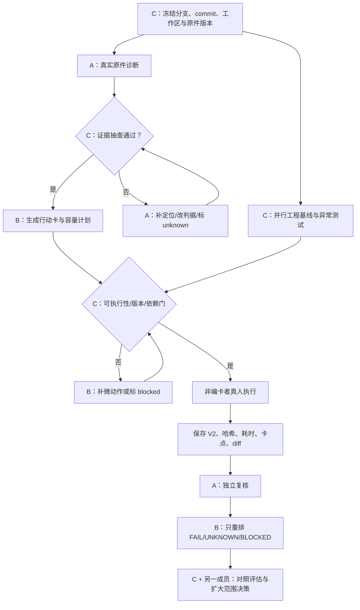

# 上岸鸭三人分工优化版总调度：按真实作品、依赖与省一质量门推进（2026-10-26）

仓库：`phucmanh146-dot/shangan-ya`  
依据：`docs/team-total-dispatch-and-provincial-first-prize-acceptance-2026-10-25.md`、`docs/product-goal-original-features-and-team-dispatch-2026-10-26.md`、`docs/personalized-first-step-provincial-prize-dispatch-2026-10-26.md`  
核心主线：**C 冻结基线 → A 证据诊断 → C 抽查放行 → B 生成个性化行动卡 → 非编卡者执行真实 V2 → A 独立复核 → B 只重排剩余项 → C 汇总评估。**

> 本文件是三人协作与执行顺序的优化版调度，不代表代码、模型、八个真实项目或省一质量已经全部验收通过。任何没有当前版本、原件证据和实际运行记录的事项均标记为 `not_run`、`unknown` 或 `blocked`。

## 1. 本轮总目标：先跑通一条，再扩大到八个样本

不是让 A、B、C 同时各自“把自己的项目做完”，而是让三个人沿同一条可追溯链交接，减少重复分析、无证据规划和做完没人复核的问题。

```text
官方赛事/目标判据 + 当前代码版本 + 真实作品 V1
                         ↓
C：冻结分支、commit、工作区、原件版本与哈希
                         ↓
A：读取原件，逐条提出证据支持的 gap
                         ↓
C：抽查原文是否支持 gap；不支持就退回 A
                         ↓
B：仅消费通过的 gap，生成具体行动卡和容量排程
                         ↓
非编写行动卡的人按卡执行，提交真实 V2 与差异记录
                         ↓
A：按冻结的原标准独立复核 V2
                         ↓
B：只重排 FAIL / UNKNOWN / BLOCKED 项
                         ↓
C + 另一成员：工程回归、对照评估、决定是否扩大范围
```

第一阶段只选择**原件可读取、授权清楚、版本明确**的两个业务链差异较大的样本。按既有分工优先从 A 负责的嘉农芯生、B 负责的湘匠织秀、C 负责的无界智泊中选取可用原件；如果材料不可读，不准为了赶进度假装已完成，登记阻塞并选择已有授权、证据齐全的替代样本。第一条真实闭环通过后再扩大到全部八个样本。

## 2. 三人主责不变，但把交付物和交接门写清楚

### A 同学：证据诊断负责人 + 独立复核负责人

负责样本：嘉农芯生、滴水润疆、菌润乡土；并按既有安排为文玩玉米、本草云联、湘匠织秀等 B 负责样本提供 gap 证据；对无界智泊等 C 集成样本进行内容交叉检查。

必须交付：
1. 作品 V1 原件清单、版本、可读状态与原件定位。
2. 每个 gap 的 `gap_id`、原文/代码定位、材料版本、目标判据、证据支持性、影响程度和 `unknown` 项。
3. 参考方法/省一对照依据及其公开来源定位；官方评分表未取得时不得把内部质量维度说成官方评分。
4. V2 独立复核记录：每条 `PASS / FAIL / UNKNOWN`，说明证据位置与原因。

禁止：
- 不得只交摘要、空模板或没有 locator 的“问题清单”。
- 不得替 B 预先假定行动方案。
- 不得复核自己实际执行的 V2；如果 A 参与了执行，必须指定另一位非执行者复核。
- 不得为了让项目通过而事后修改冻结的验收标准。

**A 的放行条件：** C 抽查原件后确认 gap 由证据支持；缺材料、引用不支持或项目版本不明的 gap 退回或标记 `UNKNOWN/BLOCKED`。

### B 同学：个性化行动卡、真人执行与剩余项排程负责人

负责样本：文玩玉米、本草云联、湘匠织秀；接收 A 提供的 gap 后再规划行动。B 也负责按复核结论更新剩余任务，但不得覆盖已完成、执行中、待复核或锁定项。

必须交付：
1. 与 `gap_id` 一一对应的行动卡：具体文件/页面/代码位置、操作步骤、原因、预计耗时范围、依赖、可见产物、自检标准和失败后的下一步。
2. 容量排程：用户可用时间、截止日期、阻塞依赖、优先级；超出时间容量的任务标为 `UNSCHEDULED`，不虚构能完成。
3. 真人执行记录：执行者、开始/结束时间、实际耗时、求助次数、失败尝试、V2 路径/哈希和 V1→V2 diff。
4. A 复核后只针对 `FAIL/UNKNOWN/BLOCKED` 项生成下一版行动卡，并提交计划前后 diff。

禁止：
- A 未提供并通过证据门的 gap，不得先猜问题、先重写作品或先做大而全的 PPT。
- 不得把“生成行动卡”当成“执行完成”。
- 不得用模型生成的完成报告、人工批注副本或静态截图冒充真实 V2。
- 不得重新打开或清空已完成项来制造“重新排程”。

**B 的放行条件：** 未参与编写的人可以只看原件和行动卡就完成任务，并产出可检查的真实结果。

### 队长 C：工程集成、依赖调度与质量放行负责人

负责样本：数智助老、无界智泊；同时统筹全队代码基线、模型接入、状态机、版本保护、测试和最终省一对照汇总。

必须交付：
1. 目标分支、commit、工作区状态、测试环境、原件版本与 SHA256；说明历史 provenance 与当前源码是否一致。
2. 对 A 的 gap 做证据抽查，对 B 的行动卡做可执行性和容量抽查。
3. 工程回归：状态转换、旧版本冲突、重复提交、模型不可用、超时、恢复、失败分支、已完成项保护。
4. 真实模型状态必须区分 `MOCK / SIMULATED / LIVE`；模型未配置或未真实调用时标记 `NOT_RUN/BLOCKED`。
5. 同条件普通大模型基线对照、失败样本、真实用户结果与合并/发布建议。

禁止：
- 不得把单元测试通过当作真实模型、真实作品或真人效果通过。
- 不得删除 provenance/hash 检查、修改原始作品或覆盖成员未提交工作区来追求“全绿”。
- 不得将内部省一质量门槛说成官方评分表，亦不得承诺必获奖。
- 不得越过 A 证据门让 B 执行无证据任务。

**C 的放行条件：** 每一阶段都有可复现证据、明确的通过/失败/未知/阻塞状态和下一责任人；关键阻断项未清除时不批准扩大范围。

## 3. 八个样本的既有分工与优化后排程

原有样本责任保持不变；优化的是依赖顺序、首个可验收产物和并行方式，而不是重新给队友分配陌生任务。

| 样本/模块 | 主责 | 前置条件 | 第一份交付 | 后续交接 |
|---|---|---|---|---|
| 嘉农芯生 | A | C 冻结基线；原件可读且授权清楚 | 证据差距矩阵，至少 3 条候选 gap | C 抽查 → B 选 1 条通过的 gap 做首卡 |
| 滴水润疆 | A | 同上 | 原件定位、目标判据、unknown 列表 | 先完成证据诊断；首轮不要求全面改完 |
| 菌润乡土 | A | 同上 | gap 清单与来源定位 | 进入第二波，优先选能执行并复核的一条 |
| 文玩玉米 | B（依赖 A/C 提供有效 gap） | 对应 gap 已通过证据门 | 一张可由第三人执行的行动卡 | 真人执行 → V2 → A 独立复核 |
| 本草云联 | B（依赖 A/C 提供有效 gap） | 同上 | 一张对应真实业务链的行动卡 | 记录实际产物、耗时、卡点和 V1/V2 diff |
| 湘匠织秀/湘秀未来 | B（依赖 A/C 提供有效 gap） | 样本名称/版本已核对，gap 有原件支持 | 一张对应需求、授权、样品/交付链的行动卡 | 真人执行 → A 复核 → B 仅重排剩余项 |
| 数智助老 | C | 当前代码基线、真实输入与模型状态已登记 | 一条端到端调用/状态链的测试记录 | 检查真实基线、服务响应、版本与证据一致性 |
| 无界智泊 | C（A/B 交叉检查） | 状态流转原件/代码与运行环境可用 | 一条状态转换的可复现测试（正常 + 异常分支） | 集成 V1/V2、异常恢复、独立复核和总体验收 |

表中的“至少 3 条候选 gap”是交付要求，不代表当前已经存在 3 条经验证差距。项目名、版本、来源和实际材料须逐一核对；名称相似或材料缺失时先澄清，不得猜测替代。

## 4. 优化后的任务依赖图



并行规则：
- C0 必须先完成；C1 工程回归可与 A1 原件诊断并行，但不得覆盖工作区。
- A 可并行准备多个样本的原件清单，但首轮只把一个样本送入 B 的执行链，避免多人同时做大量未验证工作。
- B 可以提前检查行动卡模板、容量算法和记录格式，但在 gap 通过前不能生成“正式执行卡”。
- 真人执行与 A 独立复核不得由同一人完成。
- 第二个样本只有在第一个样本完成 V2 和独立复核，且核心工程门通过后才放行；若第一个样本被原件阻塞，则明确记录原因后换用证据齐全的替代样本。

## 5. P0–P4 执行顺序与退出条件

### P0：基线、安全和可复现（C 主责，A/B 配合）
- [ ] 记录 `git status --short --branch`、`git rev-parse HEAD`、目标分支、diff 和未提交改动。
- [ ] 核对 `learning_agent.py`、测试文件、provenance 和当前 commit；解释不一致，不删除校验。
- [ ] 确认原始作品路径、权限、版本、可读状态和哈希。
- [ ] 运行当前分支已有单测，保存命令、退出码、测试数和日志。
- [ ] 明确 mock、simulated、live 的状态展示与数据来源。

**退出条件：** 当前代码和材料版本可复现；若不能，标记 `BLOCKED`，不进入真人闭环。

### P1：真实诊断和第一张行动卡（A 主责、C 抽查、B 接收）
- [ ] A 对第一份可读样本至少提出 3 条带 locator 的候选 gap。
- [ ] C 抽查原件支持性；不支持的 gap 退回 A。
- [ ] B 只选一条高影响、可执行且在用户时间内可完成的 gap，生成 5 分钟首步卡。
- [ ] 首步卡必须写清打开哪里、具体做什么、产出什么、怎么验收、失败后怎么办。
- [ ] 用第二个业务链不同的样本验证诊断和行动卡不是换名模板。

**退出条件：** `DIAGNOSIS_READY + ACTION_READY + PERSONALIZATION_PASS`；原件缺失则 `BLOCKED`。

### P2：真实 V2、独立复核与剩余项重排（B 执行、A 复核）
- [ ] 非编卡者按卡执行并记录真实耗时、求助、失败与产物。
- [ ] 保存 V1/V2 路径、哈希、diff 和输入/输出版本。
- [ ] V2 提交后状态必须为 `pending_review`。
- [ ] A 按冻结标准逐条判定 `PASS/FAIL/UNKNOWN`。
- [ ] B 只对未通过、未知或阻塞项重新排程，保护已完成和待复核状态。

**退出条件：** 至少一条真实 V1→gap→行动卡→V2→独立复核链可被另一成员复现。

### P3：真实模型、集成与恢复（C 主责）
- [ ] 真实服务商连接、模型 ID、固定问题、真实文件分析与错误分支分别测试。
- [ ] 检查 RAG 引用 locator、Dify 工作流输入输出和 COS 版本/权限（仅在实际已接入时）。
- [ ] 测无效模型、401/429、超时、无效 JSON、重复提交、旧 expected_version、重启恢复。
- [ ] 每条记录有实际结果；未运行项不写 PASS。

**退出条件：** 关键调用与失败分支有可追溯日志；未接入组件继续标记 `NOT_WIRED/BLOCKED`。

### P4：省一质量对照与范围扩展（C 统筹，A/B 提供证据）
- [ ] 按真实目标、创新差异、证据链、可执行性、真实验证、稳定性、可复现与合规七项逐个检查。
- [ ] 同条件比较普通大模型直接建议与上岸鸭闭环：材料、任务、时间预算、判据保持一致。
- [ ] 报告首次有效动作时间、引用正确率、行动卡可执行率、V2 合格率、返工次数、失败样本和样本量。
- [ ] 先扩展到三个样本，再逐步覆盖八个样本；每扩一个样本都重新核验原件和专属验收标准。

**退出条件：** 有原始数据、失败记录和独立复核才报告试点结果；不能仅凭文档或单测宣称超过竞品或达到省一。

## 6. 统一交接卡（每次移交必须填写）

```text
handoff_id：
project_id / case_id：
负责人 → 接收人：
代码分支 / commit：
原件路径 / artifact_version / input_sha256：
gap_id / 原文 locator / 冻结判据：
本次交付物路径：
执行状态：pass / fail / unknown / blocked / not_run
预期结果：
实际结果：
日志、截图、V1/V2 diff 路径：
实际耗时 / 卡点 / 已尝试方法：
下一步及依赖：
复核人 / 复核结论：
未解决问题 / 责任人 / 截止点：
是否允许下一包启动：是 / 否（理由）
```

交接不完整时，接收人不得猜测缺失内容；退回原负责人补齐，或明确标记 `UNKNOWN/BLOCKED`。

## 7. 首周工作看板（按依赖而不是平均分配任务）

| 波次 | C/队长 | A同学 | B同学 | 本波放行条件 |
|---|---|---|---|---|
| Wave 0：基线 | 冻结代码/材料版本、跑回归、登记阻塞 | 整理原件清单和可读性 | 检查行动卡字段与容量记录模板 | 代码和材料可复现 |
| Wave 1：首个 gap | 抽查证据、跑状态/失败测试 | 完成首个样本证据矩阵 | 等待通过的 gap，不提前改作品 | gap 有原文定位且通过抽查 |
| Wave 2：首卡与执行 | 验收行动卡门、保留日志 | 为第二个样本准备证据诊断 | 生成一张首步卡并由非编卡者执行 | 真实 V2 与 diff 已保存 |
| Wave 3：复核 | 核对版本保护与状态流转 | 独立复核 V2 | 只重排未通过项 | 复核有证据，已完成项不被重置 |
| Wave 4：对照与扩展 | 汇总基线对照和阻塞 | 扩展到下一样本并保留 unknown | 执行下一张专属行动卡 | 第一条闭环可由另一成员复现 |

这是一种依赖波次，不是未经确认的日历承诺；实际日期、每日可用时间和比赛截止期需由队长结合当前真实排期填写。

## 8. 省一对照验收表：只按证据，不按口号

| 维度 | 必须提供的证据 | 不通过/阻断条件 |
|---|---|---|
| 真实问题与目标 | 原始需求、用户/场景、官方赛道或项目目标 | 只有抽象痛点、官方规则未知却声称符合 |
| 创新差异 | 与普通大模型或已有流程的同条件对照 | 只换提示词、界面或增加 Agent 数量 |
| 证据链 | 每条 gap 的原件定位、版本、来源支持性 | 引用不支持结论、仅模型摘要、文件尚未解析 |
| 可执行性 | 第三人能按行动卡完成并产出可见结果 | “优化一下/继续完善”等空泛任务 |
| 真实验证 | 真人 V2、独立复核、失败记录和基线 | 静态 Demo、mock 响应、作者自评 |
| 稳定与恢复 | 错误、超时、旧版本、重启恢复、重复提交日志 | 吞错、假成功、覆盖已完成成果 |
| 可复现与合规 | 固定 commit、材料授权、哈希、脱敏日志 | 无法复现、来源不明、泄露密钥或隐私 |

省一质量是内部工程与作品对照目标，不是官方评分表替代品，更不是获奖承诺。若官方评分标准尚未取得，先将“官方符合性”标记为 `UNKNOWN`。

## 9. 每日队长总控模板

```text
日期 / 目标 / 截止期：
目标分支 / commit / 工作区：
今日只推进的一个 project_id / gap_id：
A 今日交付及原件定位：
C 证据抽查 / 工程测试：
B 行动卡 / 产物 / 估时 / 依赖：
真实执行者 / 实际耗时 / 求助 / 卡点：
V2 / hash / diff：
A review_id / PASS-FAIL-UNKNOWN：
B 重排的剩余项：
当前阻塞 / 责任人 / 下一步：
当前状态（pass/fail/unknown/blocked/not_run）：
是否允许下一波启动及理由：
```

## 10. 本轮完成定义

只有同时满足以下条件，才称“首条调度闭环已通过”：
1. 固定代码 commit 与真实材料版本可复现；
2. A 的 gap 有原件定位，C 已抽查；
3. B 的首步卡能由第三人执行，且符合用户可用时间；
4. 真人产出 V2，保存 V1/V2 diff、耗时和卡点；
5. A 按冻结标准独立复核；
6. B 只重排 FAIL/UNKNOWN/BLOCKED 项，已完成项保持不变；
7. C 与另一成员复核日志并完成普通大模型基线对照或明确记录尚未运行的原因。

在此之前，状态只能描述为“方案已建立 / 部分工程检查已执行 / 真实闭环待验收”，不能写“已超越竞品”“已达省一”或“工程全跑通”。


---

## 10. 按两份简历 Agent 作品校准后的调度修订（2026-10-26）

### 10.1 参考边界：学产品能力，不照搬简历项目工程

本节将两份简历项目作为产品与技术能力参照，不将其项目经历、性能数字或“8/8 测试通过”转写为上岸鸭自己的成果。

| 参考作品 | 可借鉴的能力 | 在上岸鸭中的落点 | 不照搬的部分 |
|---|---|---|---|
| ScholarMind — AI 论文阅读 Agent | 论文导入与理解、结构化笔记、多轮追问、跨文档检索、RAG、引用自检、必要时联网补充概念 | 作为“复杂资料理解”能力样例：把论文/项目材料转成可定位证据，再交给 A 诊断和 B 规划 | 不把上岸鸭改成论文摘要工具；不直接复制其 Dify Chatflow、Prompt、模块划分或简历中的测试结论 |
| AI 智能学习助手后端系统 | API 契约、数据持久化、缓存/异步处理、流式响应、向量检索、接口测试与错误处理意识 | 用来审查上岸鸭已有后端的接口、任务状态、资料版本、检索结果与异常分支 | 不因简历列出 FastAPI/MySQL/Redis/SSE/ChromaDB 就重写现有架构；不复用未经独立验证的 QPS、性能提升或首字延迟数字 |

**本轮工程原则：先盘点并验证仓库已有模块，再为缺口加适配层；不为堆技术名词重写底座。** Dify、RAG、向量库、对象存储、SSE 只有在仓库与部署环境确实具备、且能支撑验收时才记为已接入。未运行一律标记 `not_run`、`unknown` 或 `blocked`。

### 10.2 把论文阅读能力嵌入上岸鸭原闭环

论文阅读不是新增一条独立产品主线，而是“真实材料理解”模块的一种输入类型。输出必须继续服务于真实作品推进。

```text
真实论文 / 项目方案 / 竞赛材料 V1
        ↓
材料接入：解析状态、来源、版本、页码/章节/段落定位
        ↓
检索与理解：问题改写 → 文档片段检索 → 结构化提取
        ↓
A：证据诊断（主张/当前证据/目标判据/gap/unknown）
        ↓
C：原件定位与引用支持性检查
        ↓
B：个性化微动作（5 分钟首步、依赖、产物、自检、失败下一步）
        ↓
真人执行并提交真实 V2
        ↓
A（非执行者）独立复核
        ↓
B 只重排 FAIL / UNKNOWN / BLOCKED 项
        ↓
C 汇总运行轨迹、回归结果和对照证据
```

论文输入时，结构化笔记至少区分：研究问题、研究背景、方法、数据/实验、结果、作者主张、局限、术语解释、可追溯引用与未知项。不能把模型概括的结论直接当作作品 gap；必须对照用户目标和原件证据。跨论文比较要分别保留每篇论文的出处，不能把不同论文的结论混成一个来源。

### 10.3 三人职责与交付顺序（不改原分工）

| 顺序 / 负责人 | 本轮任务 | 必须交付 | 放行条件与下游 |
|---|---|---|---|
| C0 / 队长 | 冻结目标分支、commit、工作区；盘点当前解析器、存储、检索、模型调用、状态机和测试入口 | 基线记录、模块清单、现有/缺失/未验证能力表、原件版本与哈希 | 不覆盖队友改动；所有“已实现”必须有代码位置或运行证据 |
| A1 / A 同学 | 用真实论文和真实项目材料测试读取、定位、理解与差距诊断 | 每个样本的材料版本、可读状态、引用 locator、结构化摘要、候选 gap、unknown 清单 | C 抽查原文是否支持结论；材料未解析或引用不支持时不得放行 |
| C1 / 队长（可与 A1 并行） | 验证现有检索/工具调用/数据存储链路；缺口先写接口契约，不直接换技术栈 | 输入输出 schema、错误分支、版本保护与 trace 测试结果 | mock、simulated、live 分开；组件未连接不得写“已集成” |
| B1 / B 同学 | 只根据通过证据门的 gap 生成可执行首步和后续排程 | 每条 gap 对应 action card：材料位置、具体动作、原因、预期产物、估时、依赖、自检、失败下一步 | 第三人能只看原件和卡片执行；超出用户时间容量的任务标记 `UNSCHEDULED` |
| C2 / 队长 + A/B | 把检索、诊断、行动卡接入现有调度器；校验状态迁移、材料版本与失败分支 | 端到端 trace、输入输出版本、异常日志、回归报告 | 不绕过 `expected_version`、证据门、pending_review 与已完成保护 |
| B2 / 非编卡者 | 在真实论文阅读任务或真实竞赛/科研作品上按卡操作 | 实际耗时、卡点、求助记录、真实修改后的 V2、V1/V2 diff 和哈希 | 不允许用 AI 生成的“完成总结”代替真实产物 |
| A2 / A 同学或另一位非执行者 | 按冻结标准独立复核 V2；不得由执行者自评代替 | 逐条 `PASS / FAIL / UNKNOWN`、引用定位、判断理由与 review_id | UNKNOWN 不算通过；原标准不得事后放宽 |
| B3 / B 同学 | 根据复核只重排未解决项 | 剩余任务计划及前后 diff | 保留 `completed`、`in_progress`、`pending_review`、`locked` |
| C3 / 队长 + 另一成员 | 汇总真实测试、失败样本、工程回归与普通 LLM 基线对照 | 可复现证据包、评测结果、下一轮优先级与合并建议 | 真实材料闭环、独立复核和关键回归门均有证据后才扩大样本 |

### 10.4 依赖与执行波次

**Wave 0 — 工程与资料基线（C 主责）**
- 核对真实分支/commit、未提交改动、测试命令、模型配置和已连接组件。
- 选取至少一篇团队有权使用、可读取的真实论文，以及一个有授权且版本明确的竞赛/科研作品。
- 对每份材料记录文件哈希、解析状态和可回查定位；不能读取的样本先标 `blocked`。

**Wave 1 — 论文阅读能力验证（A 主责，C 抽查）**
- 验证核心问题、方法、实验/数据、结果、局限和术语解释是否能回到原文。
- 对每个事实性结论检查引用支持性；资料不足时输出 `UNKNOWN`，不以联网补充内容冒充论文原文。
- 输出结构化证据包，不直接把摘要当作诊断结论。

**Wave 2 — 上岸鸭个性化首步（B 主责，依赖 Wave 1）**
- A 提交且 C 抽查通过的 gap 才能进入规划。
- 首张行动卡应在 5 分钟内能开始，并留下可见产物，例如：定位一处论文方法与作品方案不一致之处、补一条有出处的相关工作、验证一个实验主张的来源。
- 行动卡必须与该用户的真实水平、目标、截止时间和可用时间相适配；同一模板不能只替换项目名。

**Wave 3 — 真人执行、版本保护和独立复核（B 执行，A 复核，C 监控）**
- 记录真实开始/结束时间、失败尝试、求助次数、V2 文件/哈希和 diff。
- V2 提交后保持 `pending_review`；A 按原判据复核。
- 只针对 FAIL/UNKNOWN/BLOCKED 生成下一轮任务，不清空已完成项。

**Wave 4 — 跨场景复用和对照（C 统筹）**
- 将同一套闭环用于至少两个差异明显的真实样本：论文阅读与竞赛/科研作品。
- 在同样材料、任务、时间预算和验收判据下，对照普通大模型直接建议与上岸鸭闭环。
- 报告样本数、失败样本、分母、测试环境和版本；小样本只说明本轮试点，不外推为普遍效果。

### 10.5 本轮必测验收矩阵

| Case | 输入/操作 | 通过标准 | 失败判定 |
|---|---|---|---|
| PAPER-01 原文定位 | 问论文中的一个明确主张 | 回答带页码/章节/段落等可回查 locator，原文支持结论 | 只有泛化摘要或引用无法定位 |
| PAPER-02 方法与结果 | 分别询问研究方法、实验设置和结果 | 三者区分清楚，不将作者推测写成实验证据 | 混淆方法/结果/讨论 |
| PAPER-03 局限与未知 | 询问论文没有报告的内容 | 明确说未报告/未知，提出需要补充的材料 | 编造数据或结论 |
| PAPER-04 跨论文比较 | 输入两篇真实论文 | 每个比较点分别引用对应来源，差异可追溯 | 将两篇来源混用 |
| PAPER-05 RAG 无命中 | 提问材料中没有答案的问题 | 返回 unknown/无可靠证据，并给补资料或替代路径 | 无依据作答 |
| PAPER-06 版本更新 | 更新论文或项目材料后重用旧计划 | 识别版本变化，旧 locator/计划需复核 | 旧计划静默继续执行 |
| PAPER-07 结构化笔记 | 生成研究问题/方法/数据/结果/局限笔记 | 字段完整，关键事实有出处，缺失项显式标记 | 只给无出处长摘要 |
| LOOP-01 个性化首步 | 同一目标输入不同真实作品 | gap、动作、产物、验收标准随证据变化 | 仅替换作品名称 |
| LOOP-02 容量约束 | 用户只有 5 分钟可用 | 给可开始的小动作，超出部分延期/未排程 | 首步明显超时或塞入过多任务 |
| LOOP-03 真人 V2 | 非编卡者照行动卡执行 | 有真实产物、耗时、卡点和版本差异 | 只有模型生成的完成报告 |
| LOOP-04 独立复核 | V2 提交但未完成复核 | 状态为 pending_review；复核后逐条记录 PASS/FAIL/UNKNOWN | 自动判定完成或执行者自评 |
| LOOP-05 剩余项重排 | 部分任务通过、部分失败 | 只重排未解决项，保护完成/待复核/锁定项 | 清空、覆盖或重复安排已完成项 |
| ENG-01 模型/工具失败 | 超时、无效配置、解析错误或工具异常 | 显示明确失败状态，保留脱敏日志，按规则重试或阻塞 | 静默假成功或用 mock 冒充 live |
| ENG-02 回归与恢复 | 重启、重复提交、旧 expected_version | 状态/版本正确，重复写入可控，恢复后确认项目版本 | 旧版本覆盖新成果或状态错乱 |

每个 Case 都必须登记实际执行结果、commit、输入材料版本/哈希、环境、日志/产物路径和复核人。未执行写 `not_run`；资料不够写 `blocked`；证据不支持写 `unknown`。不允许把参考简历的“8/8 Case 通过”直接复制成上岸鸭的测试结果。

### 10.6 合并与放行边界

- 文档合并只表示调度方案进入目标分支，不表示 Dify、RAG、向量数据库、COS、真实模型或论文解析已经实际接通。
- 工程回归、真实模型调用、真实材料诊断、真人 V2、独立复核与用户效果分别记录，不能相互替代。
- 先完成一个论文样本的“原文证据→gap→行动卡→真人产物→独立复核”，再完成一个竞赛/科研样本的差异化验证；关键门通过后才扩大到更多项目。
- 上岸鸭创新仍落在“证据驱动的个性化第一步 + 真实执行 + 独立复核 + 中断接续”，而不是简单声称用了 Dify、RAG 或多 Agent。
